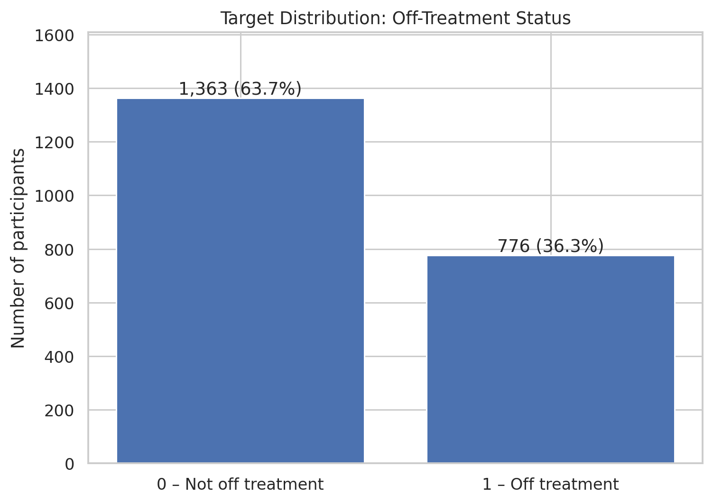
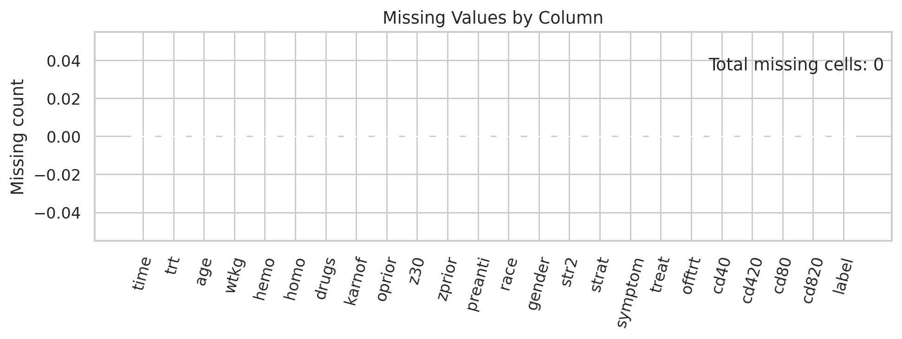
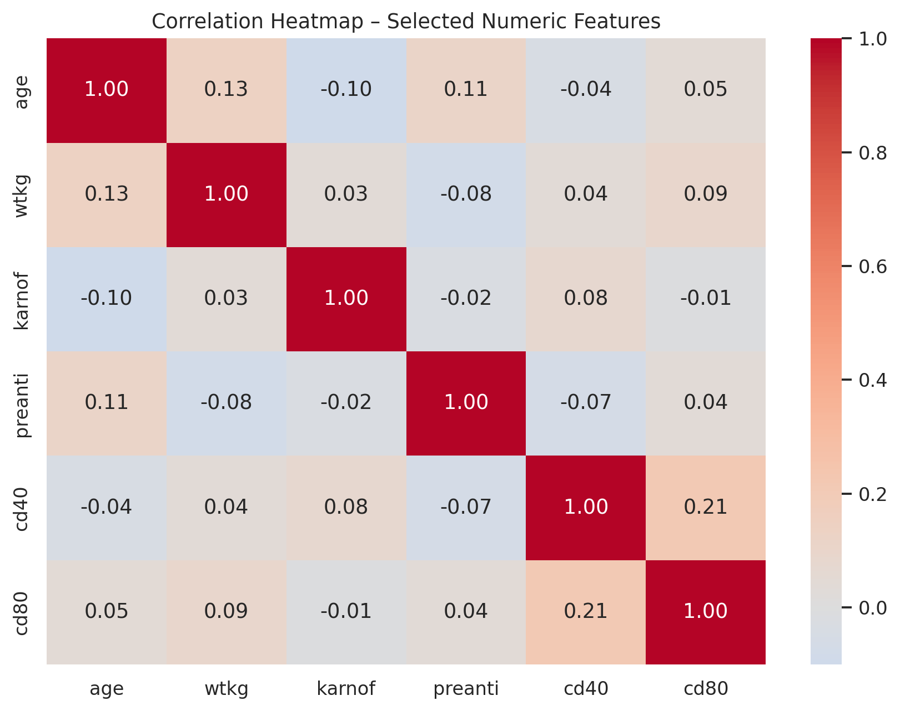

# Clinical Trial Patient Dropout Prediction


I developed this machine-learning project to study off-treatment status in an AIDS clinical-trial dataset using the available demographic and clinical variables. I compare Logistic Regression, Random Forest, and Gradient Boosting, with an emphasis on class-sensitive evaluation and model interpretability.

> **Research/educational project only.** This model is not clinically validated and must not be used to make treatment decisions or to manage real patients.

## 1. Project overview

I chose this problem because clinical-trial participant retention is important to the completeness and interpretability of trial results. In this project, I explore whether the available baseline participant characteristics can help identify participants who are recorded as off treatment (`offtrt = 1`).

I carried out exploratory data analysis, statistical association tests, feature engineering, model training, evaluation, threshold analysis, and coefficient interpretation in the Jupyter Notebook.

## 2. Problem statement and objective

**Problem I addressed:** I built a binary classification workflow to estimate the probability of the `offtrt` outcome from the available predictor variables.

**Target variable:** `offtrt`
- `0`: not off treatment
- `1`: off treatment

The project summary in my notebook describes the outcome as discontinuation of assigned treatment before approximately 96 weeks. The uploaded files do not include a separate authoritative data dictionary, so this endpoint definition and the precise operational meaning of each field should be checked against the original dataset documentation before external publication or clinical interpretation.

**What I aimed to do**
- Explore the structure and distribution of the trial dataset.
- Examine numerical and categorical associations with the target.
- Engineer a CD4-to-CD8 baseline ratio.
- Compare three classification algorithms.
- Examine class imbalance and the precision-recall trade-off.
- Interpret Logistic Regression coefficients and document the limitations of my approach.

## 3. Dataset

| Item | Value |
|---|---:|
| Rows | 2,139 |
| Original columns | 24 |
| Missing cells | 0 |
| Duplicate rows | 0 |
| Target | `offtrt` |
| Class 0 | 1,363 (63.7%) |
| Class 1 | 776 (36.3%) |

The supplied CSV is included at `data/raw/ACTG175_clinical_trial.csv`.

### Columns in the supplied file

`time`, `trt`, `age`, `wtkg`, `hemo`, `homo`, `drugs`, `karnof`, `oprior`, `z30`, `zprior`, `preanti`, `race`, `gender`, `str2`, `strat`, `symptom`, `treat`, `offtrt`, `cd40`, `cd420`, `cd80`, `cd820`, `label`.

In my analysis, I treated `trt` and `strat` as multi-level categorical variables and several 0/1 fields as categorical indicators. I examined `age`, `wtkg`, `karnof`, `preanti`, `cd40`, and `cd80` as numeric variables. A complete field-by-field data dictionary and the original download URL were **not** included in the uploaded files; do not infer clinical definitions from variable names alone.

### Target distribution



### Data quality

The uploaded CSV has no missing values and no exact duplicate rows.



## 4. Workflow and methodology

1. Load and inspect the CSV.
2. Convert selected indicator and treatment fields to categorical dtype.
3. Remove `zprior`, which is constant in this file.
4. Inspect potential outliers with the IQR rule; the notebook retains them.
5. Exclude `time`, `cd420`, `cd820`, and `label` from the predictors. I treated these as follow-up/outcome-related fields rather than baseline predictors.
6. Explore target balance, numeric feature distributions, and correlations.
7. Run independent-samples t-tests for selected numeric features and chi-square tests for selected categorical features.
8. Create `cd4_cd8_ratio = cd40 / cd80`.
9. One-hot encode `trt` and `strat`.
10. Inspect multicollinearity using VIF.
11. Split the data into training and test sets (80:20), stratified by target, with `random_state=42`.
12. Standardize selected continuous variables.
13. Train and compare Logistic Regression, Random Forest, and tuned Gradient Boosting.
14. Evaluate accuracy, precision, recall, F1, ROC-AUC, and confusion matrices.
15. Examine threshold trade-offs, train-test gaps, and Logistic Regression coefficients.

### Statistical analysis

I used t-tests for selected numeric features and chi-square tests for categorical features. These are exploratory univariate association checks; they do not establish causation. The tests use a nominal 0.05 significance threshold and do not apply a multiple-testing correction.

### Feature engineering and preprocessing

- Engineered feature: `cd4_cd8_ratio`.
- One-hot encoding: `trt` and `strat`, using `drop_first=True`.
- Scaling: `age`, `wtkg`, `karnof`, `preanti`, `cd40`, `cd80`, and `cd4_cd8_ratio`.
- Binary indicators and one-hot columns are passed through without standardization.
- Outliers detected by the IQR rule were retained in the notebook.

## 5. Models and notebook-reported results

The following values are taken from the executed outputs of my notebook. They are **not presented as an unbiased final benchmark**, because the threshold selection procedure uses the test labels (see the validation caveat below).

| Model / decision threshold | Accuracy | Precision | Recall | F1 | ROC-AUC |
|---|---:|---:|---:|---:|---:|
| Logistic Regression / 0.500 | 0.596 | 0.452 | 0.548 | 0.496 | 0.616 |
| Random Forest / 0.500 | 0.600 | 0.441 | 0.387 | 0.412 | 0.621 |
| Gradient Boosting / 0.500 | 0.621 | 0.462 | 0.277 | 0.347 | 0.593 |
| Logistic Regression / 0.448 | 0.558 | 0.436 | 0.748 | 0.551 | 0.616 |


### Selected model in the notebook

I selected **class-weighted Logistic Regression** with a decision threshold of **0.448**, prioritising recall and F1 for the positive class over accuracy.

Its recorded confusion matrix is:


| | Predicted 0 | Predicted 1 |
|---|---:|---:|
| Actual 0 | 123 | 150 |
| Actual 1 | 39 | 116 |

At this threshold, the notebook reports recall of 0.748 for class 1 and precision of 0.436. In practical classification terms, the model identifies a larger share of positive cases but also produces many false-positive alerts.

### Cross-validation and overfitting outputs

- Unbalanced Logistic Regression: 5-fold training CV ROC-AUC mean = 0.624, standard deviation = 0.035.
- Balanced Logistic Regression (threshold 0.448): train/test ROC-AUC = 0.651 / 0.616; train/test F1 = 0.554 / 0.551.
- Random Forest: train/test ROC-AUC = 1.000 / 0.621; train/test F1 = 1.000 / 0.412.
- Gradient Boosting: train/test ROC-AUC = 0.966 / 0.593; train/test F1 = 0.822 / 0.347.

The tree models show large train-test gaps in the notebook, consistent with substantial overfitting on this split.

## 6. Exploratory visualizations and findings

### Numeric features by target



### Correlation


### Logistic Regression coefficients


In my fitted Logistic Regression model, the largest positive coefficients include `drugs`, `symptom`, and `preanti`; larger negative coefficients include `strat_3`, `str2`, `cd40`, and `karnof`. Continuous predictors were standardized before model fitting, so coefficients for those fields correspond to a one-standard-deviation change, not a one-unit change in their original measurement scale. Coefficients are conditional model associations, not causal effects. High VIF values also mean coefficient interpretation should be cautious.

## 7. Important validation caveat and recommended next steps

**The threshold-tuned test metrics are not an independent final test estimate.** In the notebook, `precision_recall_curve(y_test, log_reg_probs)` is used to choose the threshold that maximizes F1, and the same `y_test` is then used to report the threshold-0.448 performance. This lets the test labels influence the decision threshold and can make the reported F1/recall optimistic.

Before presenting the tuned result as final model performance:
1. Split the original training data into training and validation subsets, or use out-of-fold predictions.
2. Select the threshold using only validation data / out-of-fold predictions.
3. Keep the test set untouched until all choices are fixed.
4. Put preprocessing and modelling in a single scikit-learn `Pipeline` so scaling is refitted within each cross-validation fold.
5. Recompute the final metrics, confusion matrix, and plots on the untouched test set.

Additional considerations:
- The reported VIF values are high for several predictors (age 16.86, weight 32.39, Karnofsky score 45.40, CD4 10.28, CD8 5.52). Investigate collinearity and consider regularization/sensitivity analysis.
- The scaler is fitted on the full training partition before cross-validation in the current notebook; fold-specific preprocessing would be more rigorous.
- I performed multiple univariate tests without a multiple-comparison correction.
- My notebook's prediction helper manually recreates feature engineering and dummy encoding. A single fitted preprocessing/model pipeline would reduce training-serving mismatch risk.
- The supplied files do not establish dataset provenance, redistribution permission, or the full feature codebook. Verify these before publishing the CSV publicly.
- This is a small, historical dataset and the recorded discrimination is modest. External validation and calibration assessment would be needed before any real-world use.

## 8. Repository structure

```text
clinical-trial-dropout-prediction/
├── README.md
├── LICENSE
├── requirements.txt
├── .gitignore
├── data/
│   └── raw/
│       └── ACTG175_clinical_trial.csv
├── notebooks/
│   └── clinical_trial_dropout_analysis.ipynb
└── results/
    ├── graphs/
    │   ├── target_distribution.png
    │   ├── missing_values.png
    │   ├── correlation_heatmap.png
    │   ├── feature_boxplots_by_target.png
    │   ├── model_performance_comparison.png
    │   ├── confusion_matrix_logistic_0448.png
    │   └── logistic_regression_coefficients.png
    └── metrics/
        └── model_comparison_as_notebook_reported.csv
```

Model `.pkl` files are not included because the uploaded notebook is the supplied reproducible analysis artifact; its final cell creates model artifacts when executed. Do not commit generated model files unless you intend to distribute them and have reviewed their contents.

## 9. Technologies

- Python
- Jupyter Notebook
- pandas and NumPy
- Matplotlib and Seaborn
- SciPy
- scikit-learn
- statsmodels
- joblib

## 10. Installation and execution

I prepared this repository from my existing notebook and CSV. I have not yet performed a clean-room execution in a newly created environment, so reproducibility should be confirmed by following the steps below.

```bash
git clone <YOUR_GITHUB_REPOSITORY_URL>
cd clinical-trial-dropout-prediction

python -m venv .venv
# Windows:
.venv\Scripts\activate
# macOS/Linux:
source .venv/bin/activate

pip install -r requirements.txt
jupyter notebook
```

Open `notebooks/clinical_trial_dropout_analysis.ipynb` and run the cells from top to bottom. My notebook's data-loading cell supports execution with the working directory at either the repository root or the `notebooks/` directory.

## 11. What I learned

Through this project, I practised taking a clinical-trial dataset through a complete classical machine-learning workflow: exploring and preparing the data, testing statistical associations, engineering a feature, comparing classification models, evaluating class-sensitive metrics, and interpreting model coefficients. The validation caveats described above are also important lessons from this work, and I plan to address them before treating the tuned results as final.

## 12. Limitations

- Moderate classification performance on the recorded split.
- Threshold selection currently reuses the test labels.
- Several predictors show high VIF values.
- No independent external validation cohort is supplied.
- Dataset provenance, redistribution terms, and complete field definitions need confirmation.
- The model estimates an association with the recorded endpoint; it does not explain why a participant discontinued treatment.

## 13. Future improvements

- Re-evaluate using a leakage-safe Pipeline and untouched test set.
- Tune the classification threshold on validation/out-of-fold predictions.
- Assess calibration (calibration curve, Brier score) and decision-analytic utility.
- Investigate multicollinearity and regularized Logistic Regression.
- Add subgroup performance and fairness checks where permitted and scientifically justified.
- Validate on an independent, appropriately documented cohort.
- Package a reusable prediction pipeline with schema validation.

## 14. Dataset attribution and licence

The uploaded notebook labels the study as ACTG 175, but the supplied files do not include the original dataset URL, source citation, or redistribution licence. **Confirm the source and permission to redistribute the CSV before making this repository public.** If redistribution is not permitted, remove the CSV from the public repository and document how eligible users can obtain it from the authorised source.

The included `LICENSE` is intended to cover original project code only, not third-party dataset contents. Replace the author placeholder and confirm that you have the right to license the code before publishing.

## 15. Author

**Satyam Chandel**  
MSc Statistics | Machine Learning | Healthcare Analytics

I developed this project as part of my work in machine learning and healthcare analytics.


---

*Prepared from the supplied notebook and CSV. Reported model results are transcribed from notebook outputs and should be re-evaluated using the validation procedure described above before being represented as final generalization performance.*

