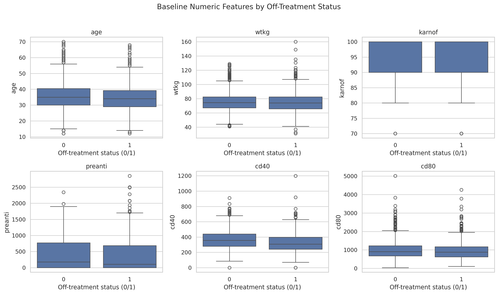
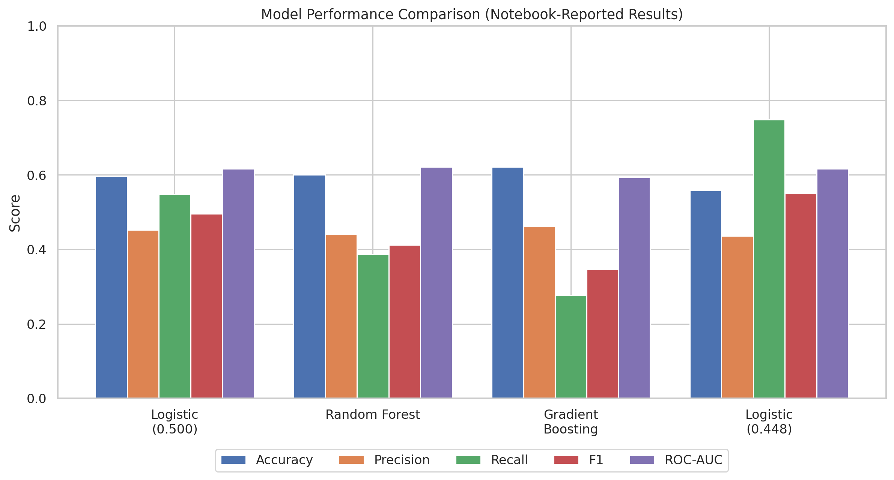
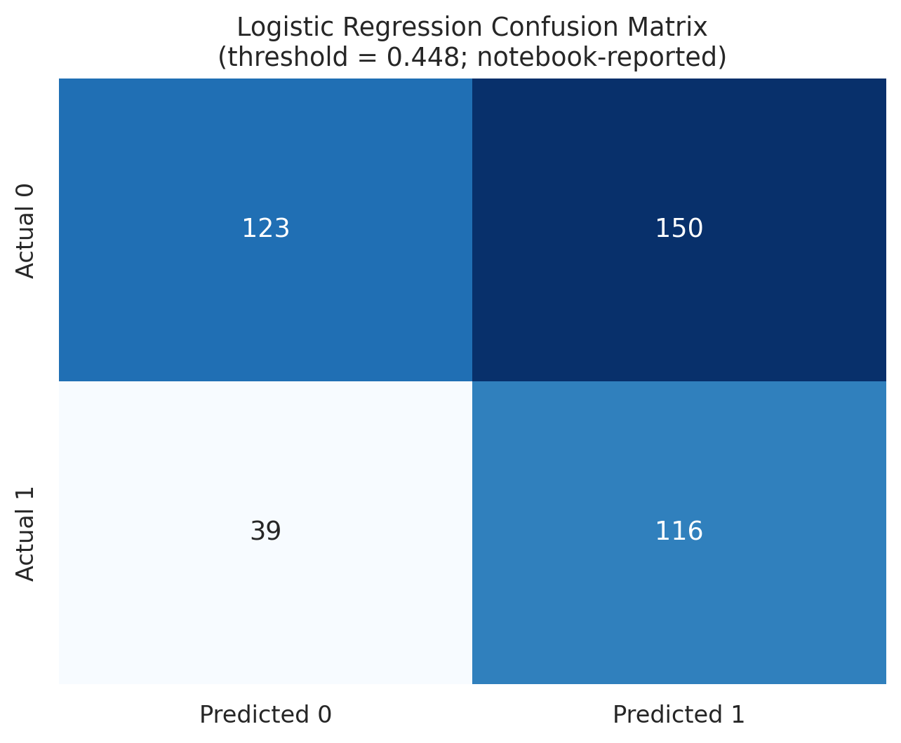
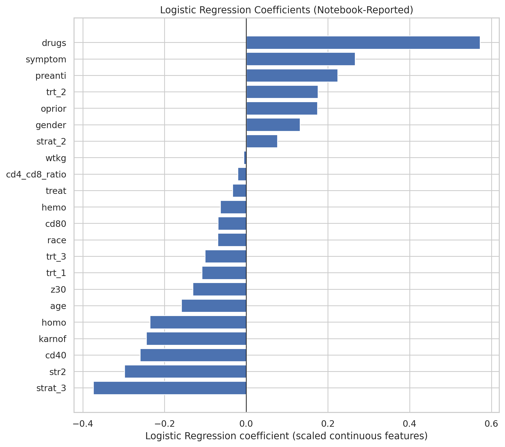

# Clinical Trial Patient Treatment Discontinuation Prediction


I developed this machine-learning project to study off-treatment status in an AIDS clinical-trial dataset using available demographic and clinical variables. I compared Logistic Regression, Random Forest, and Gradient Boosting, with an emphasis on class-sensitive evaluation and model interpretability.

> **Research/Educational Project Only:** This model is not clinically validated and must not be used to make treatment decisions or manage real patients.

---

## 1. Project Overview

Clinical-trial participant retention is important for the completeness and interpretability of trial results.

In this project, I explored whether baseline participant characteristics could help identify participants recorded as off treatment (`offtrt = 1`).

The workflow includes:
- Exploratory Data Analysis (EDA)
- Statistical association tests
- Feature engineering
- Data preprocessing
- Machine learning model development
- Model comparison and evaluation
- Decision-threshold optimization
- Model interpretation

## 2. Problem Statement and Objective

**Problem:** Build a binary classification workflow to estimate the probability of the `offtrt` outcome using available predictor variables.

**Target Variable:** `offtrt`

- `0`: Not off treatment
- `1`: Off treatment

The project summary in my notebook describes the outcome as discontinuation of assigned treatment before approximately 96 weeks. The precise operational definition should be checked against the original dataset documentation.

### Project Objectives

- Explore the structure and distribution of the dataset.
- Examine numerical and categorical associations with the target.
- Engineer a CD4-to-CD8 baseline ratio.
- Compare three classification algorithms.
- Address class imbalance.
- Examine precision-recall trade-offs.
- Interpret Logistic Regression coefficients.
- Document model limitations.

## 3. Dataset Description

The project uses the ACTG 175 clinical-trial dataset.

| Attribute | Value |
|---|---:|
| Total Observations | 2,139 |
| Original Features | 24 |
| Missing Values | 0 |
| Duplicate Records | 0 |
| Target Variable | `offtrt` |
| Class 0 | 1,363 (63.7%) |
| Class 1 | 776 (36.3%) |

**Dataset File:** `ACTG175_clinical_trial.csv`

### Dataset Feature Dictionary

The dataset contains 24 variables covering demographic characteristics, medical history, treatment information, clinical measurements, and treatment-discontinuation outcomes.

| Feature | Description | Data Type | Values / Interpretation |
|---|---|---|---|
| `time` | Time to failure or censoring | Numerical | Follow-up time in days |
| `trt` | Assigned treatment group | Categorical | 0 = ZDV only; 1 = ZDV + ddI; 2 = ZDV + Zal; 3 = ddI only |
| `age` | Participant's age at baseline | Numerical | Years |
| `wtkg` | Participant's weight at baseline | Numerical | Kilograms |
| `hemo` | Hemophilia indicator | Binary | 0 = No; 1 = Yes |
| `homo` | Historical homosexual activity indicator | Binary | 0 = No; 1 = Yes |
| `drugs` | History of intravenous drug use | Binary | 0 = No; 1 = Yes |
| `karnof` | Karnofsky performance status score | Numerical | Scale of 0–100 |
| `oprior` | Previous non-zidovudine antiretroviral therapy | Binary | 0 = No; 1 = Yes |
| `z30` | Zidovudine use during the 30 days before treatment initiation | Binary | 0 = No; 1 = Yes |
| `zprior` | Previous zidovudine use | Binary | 0 = No; 1 = Yes |
| `preanti` | Number of days of previously received antiretroviral therapy | Numerical | Days |
| `race` | Participant's recorded race category | Binary | 0 = White; 1 = Non-white |
| `gender` | Participant's recorded gender category | Binary | 0 = Female; 1 = Male |
| `str2` | Antiretroviral treatment history | Binary | 0 = Treatment-naive; 1 = Treatment-experienced |
| `strat` | Antiretroviral history stratification | Categorical | 1 = Naive; 2 = More than 1 and up to 52 weeks; 3 = More than 52 weeks |
| `symptom` | Symptomatic status indicator | Binary | 0 = Asymptomatic; 1 = Symptomatic |
| `treat` | Broad treatment indicator | Binary | 0 = Zidovudine only; 1 = Other therapies |
| `offtrt` | Indicator of being off treatment before approximately 96 ± 5 weeks | Binary | 0 = No; 1 = Yes |
| `cd40` | Baseline CD4 T-cell count | Numerical | Baseline clinical measurement |
| `cd420` | CD4 T-cell count at approximately 20 ± 5 weeks | Numerical | Follow-up clinical measurement |
| `cd80` | Baseline CD8 T-cell count | Numerical | Baseline clinical measurement |
| `cd820` | CD8 T-cell count at approximately 20 ± 5 weeks | Numerical | Follow-up clinical measurement |
| `label` | Event/censoring indicator in the supplied dataset | Binary | Refer to the original dataset documentation to confirm the exact 0/1 coding |

**Abbreviations:**
- ZDV: Zidovudine
- ddI: Didanosine
- Zal: Zalcitabine
- CD4: Cluster of Differentiation 4 T cells
- CD8: Cluster of Differentiation 8 T cells

**Important:** The feature definitions follow the documented ACTG 175 dataset terminology. The `time` and `label` fields should be checked against the exact version of the supplied CSV before interpreting their coding. The dataset's `label` variable is not the prediction target in this project.

### Target Distribution

<p align="center">
  
</p>

### Data Quality Analysis

The supplied dataset contains no missing values and no exact duplicate rows.

<p align="center">
  
</p>

## 4. Exploratory Data Analysis

The exploratory analysis included:

- Target variable distribution
- Numerical feature distributions
- Categorical feature distributions
- Correlation analysis
- Outlier detection using the IQR method
- Feature relationships with the target variable

### Correlation Analysis

<p align="center">
  
</p>

### Numerical Feature Analysis

<p align="center">
  
</p>

## 5. Statistical Analysis

I performed statistical hypothesis testing to investigate associations between predictor variables and the target variable.

| Test | Application |
|---|---|
| Independent Samples t-test | Numerical features |
| Chi-square Test | Categorical features |

The tests used a nominal significance level of 0.05.

These analyses were exploratory and do not establish causal relationships. No multiple-testing correction was applied.

## 6. Data Preprocessing and Feature Engineering

The following preprocessing steps were implemented:

1. Converted selected indicator and treatment variables into categorical data types.
2. Removed `zprior` because it was constant.
3. Examined potential outliers using the IQR method.
4. Excluded `time`, `cd420`, `cd820`, and `label` from predictors.
5. Performed exploratory data analysis.
6. Created a new feature: `cd4_cd8_ratio`.
7. Applied One-Hot Encoding to `trt` and `strat`.
8. Standardized selected continuous variables.
9. Used stratified train-test splitting.

### Engineered Feature

**CD4/CD8 Ratio**

\[
CD4/CD8\ Ratio = \frac{CD40}{CD80}
\]

### Preprocessing Techniques

| Technique | Variables |
|---|---|
| One-Hot Encoding | `trt`, `strat` |
| Standardization | `age`, `wtkg`, `karnof`, `preanti`, `cd40`, `cd80`, `cd4_cd8_ratio` |
| Train-Test Split | 80:20 |
| Stratification | Target variable |
| Random State | 42 |

## 7. Machine Learning Models

I trained and evaluated three machine learning classification algorithms.

### Models Implemented

1. Logistic Regression
2. Random Forest Classifier
3. Gradient Boosting Classifier

### Model Evaluation Metrics

- Accuracy
- Precision
- Recall
- F1-Score
- ROC-AUC
- Confusion Matrix

### Model Performance Comparison

The following results are transcribed from the executed notebook outputs.

| Model | Threshold | Accuracy | Precision | Recall | F1 | ROC-AUC |
|---|---:|---:|---:|---:|---:|---:|
| Logistic Regression | 0.500 | 0.596 | 0.452 | 0.548 | 0.496 | 0.616 |
| Random Forest | 0.500 | 0.600 | 0.441 | 0.387 | 0.412 | 0.621 |
| Gradient Boosting | 0.500 | 0.621 | 0.462 | 0.277 | 0.347 | 0.593 |
| **Balanced Logistic Regression** | **0.448** | **0.558** | **0.436** | **0.748** | **0.551** | **0.616** |

### Model Performance Visualization

<p align="center">
  
</p>

## 8. Final Model Selection

I selected **Class-Weighted Logistic Regression with a decision threshold of 0.448**.

The selection prioritised identifying a larger proportion of positive cases and improving the F1-score rather than maximising overall accuracy.

### Final Model Performance

| Metric | Score |
|---|---:|
| Accuracy | 0.558 |
| Precision | 0.436 |
| Recall | 0.748 |
| F1-Score | 0.551 |
| ROC-AUC | 0.616 |
| Decision Threshold | 0.448 |

### Confusion Matrix

<p align="center">
  
</p>

| | Predicted 0 | Predicted 1 |
|---|---:|---:|
| Actual 0 | 123 | 150 |
| Actual 1 | 39 | 116 |

The model achieved a recall of 0.748, indicating that it identified approximately 74.8% of positive cases in the recorded test split.

However, the relatively low precision of 0.436 indicates a substantial number of false-positive predictions.

### Logistic Regression Coefficient Analysis

<p align="center">
  
</p>

The largest positive coefficients included `drugs`, `symptom`, and `preanti`.

Larger negative coefficients included `strat_3`, `str2`, `cd40`, and `karnof`.

These coefficients represent conditional associations within the fitted model and should not be interpreted as causal effects.

## 9. Cross-Validation and Overfitting Analysis

| Model | Train ROC-AUC | Test ROC-AUC | Train F1 | Test F1 |
|---|---:|---:|---:|---:|
| Balanced Logistic Regression | 0.651 | 0.616 | 0.554 | 0.551 |
| Random Forest | 1.000 | 0.621 | 1.000 | 0.412 |
| Gradient Boosting | 0.966 | 0.593 | 0.822 | 0.347 |

Unbalanced Logistic Regression achieved a five-fold training cross-validation ROC-AUC mean of 0.624 with a standard deviation of 0.035.

The tree-based models demonstrated substantial train-test performance gaps, indicating potential overfitting.

## 10. Important Validation Considerations

The threshold-tuned test metrics should not be considered an unbiased estimate of final model performance.

The notebook selected the threshold using `y_test` and then evaluated the model on the same test labels.

### Recommended Improvements

1. Split the training data into training and validation subsets.
2. Select the optimal threshold using validation data or out-of-fold predictions.
3. Keep the test set untouched until all modelling decisions are finalised.
4. Use a scikit-learn Pipeline to prevent preprocessing leakage during cross-validation.
5. Recalculate the final evaluation metrics on the untouched test set.

### Additional Limitations

- Several predictors show high VIF values, indicating multicollinearity.
- Multiple univariate tests were performed without correction.
- The current prediction helper manually recreates preprocessing.
- The dataset is relatively small and historical.
- Independent external validation has not been performed.
- Dataset provenance and redistribution permissions need confirmation.

## 11. Technologies and Libraries

| Category | Technologies |
|---|---|
| Programming Language | Python |
| Development Environment | Jupyter Notebook |
| Data Manipulation | Pandas, NumPy |
| Data Visualization | Matplotlib, Seaborn |
| Statistical Analysis | SciPy, Statsmodels |
| Machine Learning | Scikit-learn |
| Model Persistence | Joblib |

## 12. Repository Structure

```text
Clinical-Trial-Patient-Treatment-Discontinuation-Prediction/
│
├── IMAGES/
│   ├── target_distribution.png
│   ├── missing_values.png
│   ├── correlation_heatmap.png
│   ├── feature_boxplots_by_target.png
│   ├── model_performance_comparison.png
│   ├── confusion_matrix_logistic_0448.png
│   └── logistic_regression_coefficients.png
│
├── ACTG175_clinical_trial.csv
├── Clinical_Trail.ipynb
└── README.md
```

## 13. Installation and Execution

### Step 1: Clone the Repository

```bash
git clone <YOUR_GITHUB_REPOSITORY_URL>
cd Clinical-Trial-Patient-Treatment-Discontinuation-Prediction
```

### Step 2: Create a Virtual Environment

```bash
python -m venv .venv
```

Activate the environment:

**Windows**

```bash
.venv\Scripts\activate
```

**macOS/Linux**

```bash
source .venv/bin/activate
```

### Step 3: Install Dependencies

```bash
pip install pandas numpy matplotlib seaborn scipy scikit-learn statsmodels joblib jupyter
```

### Step 4: Launch Jupyter Notebook

```bash
jupyter notebook
```

Open `Clinical_Trail.ipynb` and execute the cells sequentially.

The dataset is available in the repository root as `ACTG175_clinical_trial.csv`.

## 14. Key Learnings

Through this project, I gained practical experience in:

- Exploratory Data Analysis of clinical-trial data.
- Statistical hypothesis testing.
- Feature engineering using clinical variables.
- Data preprocessing and categorical encoding.
- Handling class imbalance using class weighting.
- Comparing classical machine learning algorithms.
- Evaluating classification models using multiple metrics.
- Decision-threshold optimisation.
- Interpreting Logistic Regression coefficients.
- Identifying overfitting and validation limitations.

## 15. Future Improvements

- Implement leakage-safe preprocessing pipelines.
- Perform threshold optimisation using cross-validation.
- Investigate regularised Logistic Regression.
- Address multicollinearity.
- Evaluate probability calibration using Brier score and calibration curves.
- Conduct subgroup performance and fairness analysis where appropriate.
- Validate the model using an independent dataset.
- Develop a reusable prediction pipeline with schema validation.

## 16. Dataset Attribution and Licence

The supplied notebook identifies the study as ACTG 175. The original dataset URL, source citation, and redistribution licence were not included in the supplied files.

The original dataset source and permission to redistribute the CSV should be verified before making the repository public.

The included project documentation is intended to describe original project code and analysis, not to grant rights over third-party dataset contents.

## 17. Author

**Satyam Chandel**

MSc Statistics | Machine Learning | Healthcare Analytics

This project was developed as part of my work in machine learning and healthcare analytics.

---

*Note: Reported model metrics are transcribed from the executed notebook outputs. The threshold-tuned results require independent validation before being treated as final estimates of generalisation performance.*

### Dataset References

- [ACTG 175 Dataset Documentation – CRAN BART](https://github.com/cran/BART/blob/master/man/ACTG175.Rd)
- [AIDS Clinical Trials Group Study 175 – UCI Machine Learning Repository](https://archive.ics.uci.edu/dataset/890/aids+clinical+trials+group+study+175)
